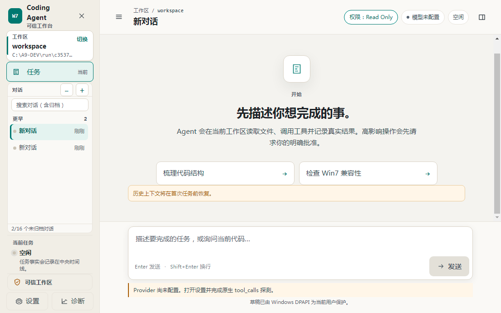
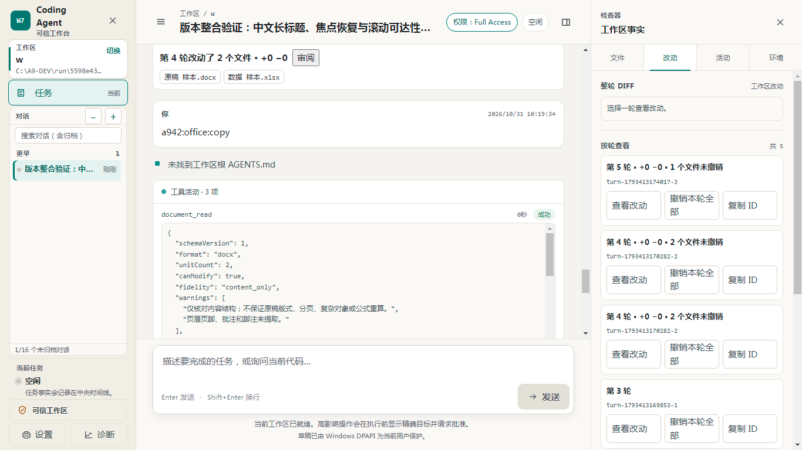
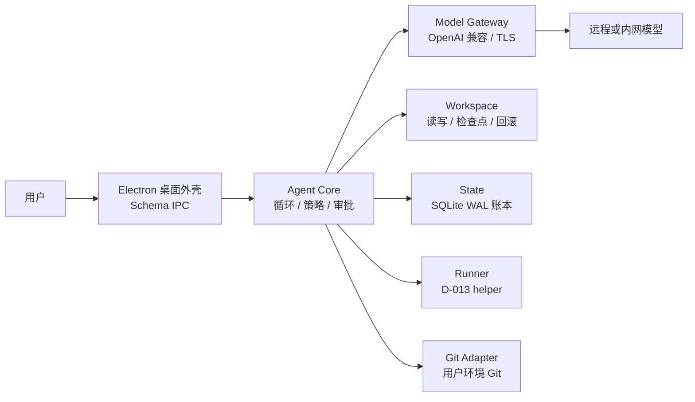

# AgentForWin7

[](https://github.com/allin2/AgentForWin7/actions/workflows/ci.yml)
[](LICENSE)
[](docs/WIN7_CONSTRAINTS.md)
[](https://github.com/allin2/AgentForWin7/releases/tag/v0.3.0-alpha.4-win7-57)

面向 **Windows 7 SP1 x64** 的桌面编码助手，产品名 Win7 Coding Agent。

模型推理在远程或企业内网的 OpenAI 兼容服务上完成，例如 DeepSeek。Win7 端负责对话界面、工作区读写、命令执行、检查点回滚和本地审计。

> 当前为内部预览版。完整 Alpha、RC 与稳定版验收尚未签发，已知限制见 [Release 说明](https://github.com/allin2/AgentForWin7/releases/tag/v0.3.0-alpha.4-win7-57)。

## 界面





截图来自 `v0.3.0-alpha.3-win7-56` 发布包在 Windows 7 SP1 x64 上的运行。对话内容是自动化测试输入。

## 主要能力

- **便携运行**：基于 Electron 22.3.27（Win7 最后支持的分支），内置 SQLite 原生模块与 D-013 helper（项目自研的 Win32 进程管理程序），解压即用，无需另装 Node.js。
- **工作区读写**：识别 UTF-8、GBK、UTF-16LE 编码，生成确定性 Diff，每轮自动建检查点，可回滚。
- **命令与 Git**：Agent 可执行 Shell 命令和 Git 操作。D-013 helper 用 Win32 Job Object 管理进程树，防止残留进程。Git 使用用户环境中已安装的 Git。
- **审批与审计**：外部写入和高影响操作需要目标绑定确认。会话、计划与操作记录写入本地 SQLite WAL 账本。
- **轻量工具**：编辑反馈、环境信息、Skills、向用户提问、图片读取，以及 Office Lite：有界读取 DOCX/XLSX、生成新稿和内容级修改副本，不承诺版式保真、宏或公式重算。

## 权限与安全

请先阅读 [安全说明](docs/SECURITY.md) 第 10 节。要点如下：

- **Full Access 模式下，Agent、Shell、Git hooks 和项目脚本拥有当前 Windows 用户的真实权限。** 产品不提供现代沙箱，Shell 网络不隔离。
- 检查点、Diff、审批和审计可以降低误操作风险，但不能保证所有副作用可逆。请在受信项目、受限账号和可恢复的工作副本中使用。
- 当前支持 Full Access 与 Read Only 两种模式。Review 模式尚未完成，进入时保持 fail-closed。
- 渲染进程不直接获得文件、进程、凭据或网络权限。Provider 凭据用 DPAPI 保存，并在日志中脱敏。TLS 默认验证。

发现安全问题时，请不要公开提交 Issue。请在本仓库 Security 页面选择 “Report a vulnerability” 私密提交。

## 下载与运行

### 系统要求

| 项目 | 要求 |
|---|---|
| 操作系统 | Windows 7 SP1 x64（Build 7601） |
| 系统补丁 | KB4474419、KB4490628（SHA-2 签名支持）；KB3140245（TLS 1.2）。从 [Microsoft Update Catalog](https://www.catalog.update.microsoft.com/) 获取 |
| 磁盘 | 建议本地 NTFS 分区 |
| 模型服务 | 一个 OpenAI 兼容端点：Base URL、API Key、模型名 |

### 启动

1. 从 [最新预发布版](https://github.com/allin2/AgentForWin7/releases/tag/v0.3.0-alpha.4-win7-57) 下载 `Win7CodingAgent-0.3.0-alpha.4-win7-x64.zip`。
2. 核对 SHA-256：`46a6f7926a084b7cdaca3d589532af50c8fc17c2de42d94302d81245369faa94`。
3. 解压到本地路径，例如 `D:\Tools\Win7CodingAgent`。
4. 运行解压目录中的 `electron.exe`。
5. 首次启动时，在设置中填写模型端点。

## 架构



详细设计见 [架构说明](docs/ARCHITECTURE.md)，平台限制见 [Win7 约束](docs/WIN7_CONSTRAINTS.md)。

## 开发

开发机与产品运行时是两套环境：

- 开发机：Node **20.17.0**，以 `.nvmrc` 为准。根目录的 better-sqlite3 按该版本编译，其他 Node 版本会在测试前停止。
- 产品：随包的 Electron 22 内置 Node 16.17.1。开发机检查通过不代表 Win7 通过。

```bash
git clone https://github.com/allin2/AgentForWin7.git
cd AgentForWin7
nvm use

# 根目录与各模块分别安装依赖
for package in . src/core src/gateway src/git-adapter src/runner src/shell src/shell/office-lite src/state src/workspace; do
  npm ci --prefix "$package"
done

npm run test:local -- --module gateway   # 单模块：先构建依赖闭包，再测该模块
npm run test:local                       # 7 个模块的日常集合
npm run docs:check                       # 文档改动
npm run verify:tools                     # 检查工具改动
npm run verify:release                   # 打包工具改动或发布准备
npm test                                 # 完整集成回归
```

`docs:check` 会核对历史提交和候选 tag，请使用完整克隆，不要用 `--depth 1`。更多入口与未执行项说明见 [scripts/README](scripts/README.md)。

### 打包

打包需要已锁定的离线输入，这些输入不在仓库中：Electron、Runner 和 Storage 三个 ZIP。

```bash
npm run package:win7 -- \
  --electron-zip <Electron ZIP> \
  --runner-zip <Runner ZIP> \
  --storage-zip <Storage ZIP> \
  --formal-input-lock release/win7-product-v3/<对应 Profile 的输入锁>.json \
  --output <新目录>
```

打包器按输入锁核对每个输入的 SHA-256，默认要求源码提交等于 HEAD 且工作区干净。开发构建不是正式候选。正式候选的构建、验收与发布流程见 [验收与发版规范](docs/acceptance/ACCEPTANCE_AND_RELEASE_WORKFLOW.md) 和 [发布说明](release/win7-product-v3/README.md)。

## 仓库结构

```text
├── src/            # 7 个产品模块：core、gateway、runner、shell、workspace、state、git-adapter
├── native/helper/  # D-013 Win32 helper 源码与各版本构建套件
├── release/        # 输入锁、发布合同与 Win7 验证驱动
├── scripts/        # 构建、检查、打包、Win7 开发通道与 CI 工具
├── validation/     # Win7 实机验证证据索引
├── spikes/         # 早期技术验证（Spike 01～04）的代码与验收证据
└── docs/           # 架构、约束、安全、决策记录、任务书与状态
```

## 文档

| 主题 | 文档 |
|---|---|
| 执行约束 | [AGENTS.md](AGENTS.md) |
| 当前状态 | [docs/STATUS.md](docs/STATUS.md) |
| 文档导航 | [docs/README.md](docs/README.md) |
| 架构 | [docs/ARCHITECTURE.md](docs/ARCHITECTURE.md) |
| Win7 平台约束 | [docs/WIN7_CONSTRAINTS.md](docs/WIN7_CONSTRAINTS.md) |
| 安全 | [docs/SECURITY.md](docs/SECURITY.md) |
| 架构决策 | [docs/DECISIONS_INDEX.md](docs/DECISIONS_INDEX.md) |
| 任务书索引 | [docs/tasks/README.md](docs/tasks/README.md) |
| 参与贡献 | [.github/CONTRIBUTING.md](.github/CONTRIBUTING.md) |

## 已移出的历史文件

2026-11-03 的仓库整理把下列文件移出当前目录，Git 历史中仍完整保留：

- Spike 02、04 构建套件中的离线输入（`kit/inputs/`，含 Electron 与 Node 安装包）。
- Python 原型阶段代码：`src/phase1-2/`、`tests/`、`scripts/run_*.bat`。
- 原生工件校验文件：`A6/*.sha256` 和根目录的 `WIN7_NATIVE_ARTIFACTS_*.sha256`。哈希值仍记录在 [Win7 约束](docs/WIN7_CONSTRAINTS.md) 中。

需要时用 `git checkout archive/pre-cleanup-20261103 -- <路径>` 取回。

## 许可证

原创代码与文档采用 [Apache License 2.0](LICENSE)。第三方依赖、运行时与构建工件遵循各自的许可证。
