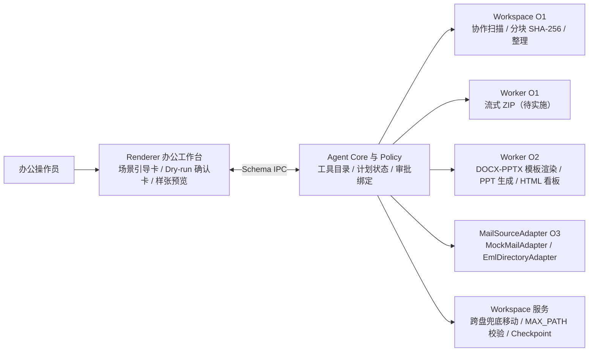

# A9-70 — 第一批办公场景改造（文件整理、模板套打与只读邮箱接口）

```text
Status: APPROVED_FOR_IMPLEMENTATION
Task Type: PRODUCT_EXPERIENCE
Target Branch: main；InstaBox 工作分支见 §7/§8
Source Baseline: 1a420eb95043cc8eca7ae70c808dca1b25649315
Phase-Gate: A9_70_IMPLEMENTATION_AUTHORIZED
Win7-Validation: NOT_PERFORMED
```

## 1. 结论与任务边界

负责人于 2026-11-16 指示“按照推荐修正表述，并且开启 instabox，实现上述内容，先给我看下如何安排，对应的模型和任务安排”，后继回复“开始做吧”。本任务为 `APPROVED_FOR_IMPLEMENTATION`，覆盖 O1～O4，按 §7 开始实施准备、模型准入及 InstaBox 派单。
后续按既有 InstaBox 工作包流程实施。新依赖在引入前完成 [WIN7_CONSTRAINTS.md §6](../WIN7_CONSTRAINTS.md#6-依赖评审登记表) 登记，接口及恢复语义变化先登记配套 ADR。此次授权不包含公开推送发布、正式门 A/B 或 Win7 目标机执行窗口。
P0、P1 与 P1b 已有开发机检查，准确范围见 §10。ZIP、模板、汇报、邮件与办公 UI 仍待实施；Win10 验收机与 Win7 实机为 `NOT_PERFORMED`。

### 1.1 纳入范围（第一批）

| 编号 | 模块 | 交付目标 | 已确认边界 |
|---|---|---|---|
| O1 | 智能文件整理、版本去重与交接归档 | 目录元数据扫描、Dry-run 预览勾选、批量移动与归档打包 | 分开呈现 SHA-256 相同副本与疑似版本；仅执行操作员确认的隔离计划；无密码标准 ZIP 兼容范围经目标环境验证后声明 |
| O2 | 模板批量套打与汇报汇编 | 支持范围内的 DOCX/PPTX 模板填充、固定版式 PPTX 从零汇编、离线单文件 HTML 看板 | 保留受支持模板结构，不承诺任意内容下分页与版式不变；普通样张和边界数据样张确认后批量输出；不转 PDF |
| O3 | 本地邮箱与附件收割 | 统一只读 `MailSourceAdapter` 接口、`MockMailAdapter` 与 `.eml` 导出目录解析 | 保留后续接入真实邮箱协议的接口；第一批先落 Mock 模拟适配器与 `.eml` 本地解析，只读提取附件并汇总正文待办 |
| O4 | 办公向引导与安全确认交互 | 场景引导首页、Dry-run 勾选确认卡与文档交付摘要 | 工程参数收拢至高级设置，保留首次模型配置入口；批量动作预览确认；撤销须通过恢复条件检查 |

### 1.2 明确排除项（不在本任务范围内）

- **需求 3（脏表清洗、三方对账与复杂表格）**：暂不纳入第一批，仅保证工具命名与目录结构不冲突。
- **需求 4（PDF 解析、格式互转与 Office 转 PDF）**：取消立项；不引入 PDF 文本提取库、本地 Office COM 探测或内网转换服务端。
- **需求 5（票据与扫描件识别入账）**：暂不做；保留现有基础 `read_image` 能力，不放宽图片像素上限，不引入 OCR。
- **需求 6（合规体检与文本审查）**：暂不做；不新增敏感词脱敏替换引擎、标书装订检查与合同红线审查。
- **需求 8（老旧系统桌面 RPA）**：明确放弃，不做任何桌面控件模拟点击与按键注入。
- **其余排除能力**：带密码 7z 压缩、不同内容 Word 语义比对、Outlook `.pst` 与 Foxmail 私有邮箱库直读、自动发信与删除服务端邮件、管理员提权。

---

## 2. 总体架构与隔离边界

第一批复用既有 `Electron 22.3.27 / Node 16.17.1` 的 Worker 线程与受控工作区服务，不改动 `D-013` 原生 helper 与 SQLite 原生绑定，不赋予 Renderer 文件或系统权限。Worker 线程不构成安全沙箱；现有 V8 堆限额不等于进程总内存上限，Buffer、解压数据与批量队列另设容量边界并实测。

Agent 负责理解意图、分类建议、字段映射与有来源的摘要；宿主程序负责哈希、路径校验、模板替换、批量执行与结果核对。文件生成与解析不要求安装 Office；模型推理仍使用已配置服务，不承诺完整离线推理。



---

## 3. 分模块详细技术方案

### 3.1 模块 O1：智能文件整理、版本去重与交接归档

#### 现有差距（依据源码）
- 现有 `list` 返回结构体缺少文件修改时间与哈希字段，且单次返回上限为 `2000` 条（[a9-workspace-service.ts](../../src/workspace/src/a9-workspace-service.ts)）。
- 现有 `move` 直接调用 `fs.renameSync`，在 Windows 跨盘移动（如 C 盘移往 D 盘）时会报 `EXDEV` 失败。
- 单次只允许调用一个文件工具，整理几百个文件需循环数百轮模型；现有 [office-lite-zip.js](../../src/shell/product/office-lite-zip.js) 仅用于 `4 MiB` 内内存解包。

#### Win7 实现设计
1. **流式只读扫描索引器（新增工具 `workspace_scan_metadata`）**：
   - 在 Node 16 Worker 内分页递归扫描选定目录树，收集相对路径、扩展名、`sizeBytes` 与 `mtimeMs`。
   - **分层哈希降耗**：先按 `sizeBytes` 分组，大小唯一的文件直接跳过哈希；仅对大小完全一致的组流式分块计算 `SHA-256`，避免老旧机械硬盘无谓全盘读大文件。
   - **自动忽略干扰文件**：跳过 Office 临时锁文件（`~$*.docx`、`~$*.xlsx`）、`.git`、系统隐藏属性文件及符号链接环。
2. **Dry-run 计划协议与宿主批量执行（新增工具 `batch_organize`）**：
   - **第一阶段**：模型结合扫描结果与目录 `AGENTS.md` 生成结构化 JSON 整理方案（动作限定为 `move`、`rename`、`quarantine_duplicate`、`skip_conflict`），前端展示带勾选框的确认列表。
   - **第二阶段**：操作员确认后，宿主按计划 ID、准确动作清单与基线哈希执行。SHA-256 相同只证明内容字节相同，不证明副本没有业务用途；文件名与修改时间只提供版本候选，不据此自动隔离。仅将确认的目标移入 `_待清理隔离区_YYYYMMDD`，不永久删除。
   - **整理清单交付**：执行结束后自动输出《文件整理与去重清单》（Markdown 与 UTF-8 BOM 可选 CSV）供肉眼复核。
3. **Win7 文件系统边界兜底**：
   - **跨卷搬运（`EXDEV`）**：以实际卷身份及 rename 错误判定，不只比较盘符。复制到目标同级临时文件，核验源身份、源内容与目标 SHA-256；按不覆盖冲突目标的规则发布目标，再记录恢复状态并处理源。明确取消、崩溃和重启各阶段的对账行为；未经故障验证不承诺断电无损。
   - **文件错误分类**：确认属于单文件占用时，跳过并报告。`EPERM` 也可能是权限失败，不统一标为占用；目录身份、完整性、恢复记录或权限边界失败时停止依赖动作。
   - **长路径预警（`MAX_PATH`）**：批执行前预检所有目标绝对路径长度；超过 `240` 字符时在预览清单标红拦截，提示操作员缩短文件夹层级或文件名。
4. **无密码标准 ZIP 归档（新增工具 `archive_create_zip`）**：
   - 在 Worker 引入经验证兼容 Node 16 的流式 ZIP 库，按清单写入新路径；源扫描排除输出及临时文件。固定压缩方法、文件数和大小边界，验证中文文件名及 ZIP64 适用性后声明 Win7 资源管理器兼容范围，不以标准 ZIP 名称替代实测。

### 3.2 模块 O2：模板批量套打与汇报汇编

#### 现有差距（依据源码）
- 现行 [office-lite-engine.js](../../src/shell/product/office-lite-engine.js) 使用 `docx 8.0.0` 从零拼接简化块，对外部 `.docx` 模板标记 `canModify=false`，无法保留红头、页眉页脚、签章留白与表格样式（[A9-42 Office Lite 范围](../plans/A9_42_OFFICE_LITE_SCOPE.md)）。
- 现行 [a9-office-service.js](../../src/shell/product/a9-office-service.js) 显式拒绝 `.pptx`，且单次写入上限 `256 KiB` JSON。

#### Win7 实现设计
1. **受支持模板的占位符解析与填充（新增 `template_inspect`、`template_render_sample`、`batch_render_templates`）**：
   - 保留原有从零生成入口，新增模板填充路径。验证跨文本节点占位符、循环明细与页眉页脚能力，公布支持结构。保留模板样式资源，不承诺字体缺失、长文本、跨页表格或文本框溢出时仍保持原分页与版式；不支持的结构显式拒绝或告警，不静默丢失。
   - 继承既有安全守卫：拒绝含宏（`vbaProject.bin`）、外部关系链接及 XXE 实体的模板；填入数据先经 XML 转义与控制字符清洗，不执行任何模板内脚本表达式。
   - **两段式人工把关**：先输出字段映射及普通样张，补充最长字段、空值和多行明细的边界样张。操作员在指定 Office/WPS 查看环境确认后，才批量输出。生成不依赖本机 Office，版式确认不能仅用 XML 回读代替；文件名和输出冲突经宿主校验。
2. **结构化汇报 PPTX 生成（新增 `presentation_create`）**：
   - 支持两种出稿路径：向企业现有 `.pptx` 母版占位符填数，或基于纯 JS 库按 5 套固定版式（封面、目录、双栏对比、表格、总结）从零生成整齐的 `.pptx` 初稿。
   - 汇总多份会议记录与部门数据时，要求每页数据注脚标明来源文件名。
3. **离线单文件 HTML 数据看板（新增 `html_report_create`）**：
   - 零新增第三方前端框架依赖，使用产品内置单文件模板注入指标与明细，内联 CSS 与原生 SVG 图表（无外部网络资源引用，数据做 XSS 转义）。
   - 首先以应用内 Chromium 108 受限预览为查看基线，禁止 Node 权限、外部导航和网络资源。外部浏览器兼容范围单列验证；ES5 语法不证明 DOM、SVG 或 CSS 兼容，亦不承诺 Win7 任意默认浏览器可用。产品报告使用业务来源说明，不套用内部解说材料的非事实来源标签。

### 3.3 模块 O3：本地邮箱与附件收割（只读适配器 + Mock + `.eml`）

#### 实现设计
1. **统一只读接口（`MailSourceAdapter`，`schemaVersion: 1`）**：
   - 适配器负责只读列文件夹、分页列邮件、取正文及读取附件内容；提供稳定来源标识、邮件标识、分页和错误语义。`extractAttachments` 是宿主写操作，由 Workspace 执行路径校验、冲突保护、确认与恢复记录，不由只读适配器任意落盘。
   - 禁止发信、删信和修改远端状态。真实 IMAP 或企业网关后续需补认证、超时、增量同步及实际协议验证；当前预留接口，不承诺仅新增实现类即可完整接入。
2. **第一批双内置适配器**：
   - **`MockMailAdapter`**：读取本地可配置的 JSON 邮件测试夹具（含中文标题、线程往来与多附件二进制占位样本），用于在无邮箱环境完整跑通界面收割、附件归档与待办汇总流程。按项目规则，`MockMailAdapter` 产出证据在报告与状态标识中必须标为 `SURROGATE`，不得冒充真实邮箱连通结论。
   - **`EmlDirectoryMailAdapter`**：使用纯 JS MIME 解析库只读读取工作区内用户导出的 `.eml` 文件夹，自动处理 UTF-8、GBK/GB2312 与 Base64 编码附件。
3. **安全与不可信数据隔离**：
   - 依据 [A9 PRD §3](../prds/WIN7_TRUSTED_CODING_AGENT_REQUIREMENTS_V1.md#a9-t03-工具调用正确性)，邮件主题与正文严格标记为不可信数据注入模型上下文，禁止邮件正文文本直接触发工具权限提升。
   - 附件名称按不可信输入处理，拒绝路径穿越、绝对路径、保留设备名及同名覆盖；设置单附件与总量上限。阻断可执行脚本，保留告警，不自动打开附件。Mock 在 UI 明示为模拟数据，证据标为 SURROGATE；真实联网邮箱后续落实 DPAPI 与 TLS。模型摘要遵守既有 Provider 数据流，不将本地解析描述成数据永不离机。

### 3.4 模块 O4：办公化产品包装与预置模板

1. **首页场景引导与工程参数收拢**：增设三个办公场景入口，沿用现有工作台；保留首次模型配置与连接错误入口，将预算和 thinking 收拢至高级设置。
2. **统一预览确认与交付摘要**：共享计划确认与交付卡片，显示成功、跳过、失败与可恢复状态。撤销前检查文件身份及后续人工变更，冲突时停止覆盖并解释原因；未经新增操作的恢复验证，不显示无条件一键撤销承诺。
3. **内置预置 `Skills` 包**：利用既有 [a9-skills.ts](../../src/core/src/a9-skills.ts) 按需索引机制，内置常见命名整理、公文套打与邮件待办汇总指令样本，一键复制到新建工作区 `.agents/skills/`（不超过 `32 KiB` 单文件上限）。

---

## 4. C15/C16 新增纯 JS 依赖与准入

所选准确版本及传递闭包须在 `Node 16.17.1` 实际加载，不以纯 JS、缺少 engines 字段或最低版本文字代替兼容证明。严禁目标机在线安装。r2 准入与工件见 ADR-0336、WIN7_CONSTRAINTS §6 及 src/shell/office-lite/DEPENDENCIES.json。该闭包已安装在开发机；Win7 仍为 NOT_PERFORMED。

2026-11-16 元数据核对发现 `mailparser 3.14.5` 声明 Node >=20，不可直接用于产品。应评估兼容历史版本的维护与安全风险，或提出其他候选；不静默升级产品 Node。`pizzip 3.3.0` 声明 MIT OR GPL-3.0，双许可证不等于强制选择 GPL，按所选许可核验完整分发闭包。

| 拟新增模块用途 | 候选库方向 | 待 C15/C16 核验的重点风险 |
|---|---|---|
| 流式生成标准无密码 ZIP（O1） | `yazl` 或 `archiver` | 确认传递依赖数量、中文文件名 UTF-8 flag 支持与大文件流式内存峰值 |
| DOCX/PPTX 原版式占位符填充（O2） | `docxtemplater` 开源基础版及 ZIP 读写底座 | **重点核查许可证**：核验模板与 ZIP 底座的精确开源许可证（确认无 GPL 传染或商业闭源模块混入），核实 Word XML 断词拆分处理能力 |
| PPTX 结构化从零生成（O2） | `pptxgenjs` | 确认与 `Node 16.17.1` 兼容性、包解包体积与中文基础字体占位输出 |
| `.eml` 邮件 MIME 解码（O3） | `mailparser` | 确认无原生依赖、在 `Node 16` 下的流式解析内存控制与 GBK 中文附件名解码 |

---

## 5. 拟改动范围与禁止边界

### 5.1 实施定位与职责
- 工具目录与参数 Schema：[a9-tools.ts](../../src/core/src/a9-tools.ts)。
- 跨盘复制兜底、路径长度预检与批量文件管理：[a9-workspace-service.ts](../../src/workspace/src/a9-workspace-service.ts)。
- 办公引擎依赖锁与 Worker 服务：`src/shell/office-lite/`、[a9-office-service.js](../../src/shell/product/a9-office-service.js) 及新增邮箱适配器模块。
- Runtime、Schema IPC、Preload 与 Renderer 办公场景卡片：`src/shell/product/`。
- 派单模型与强度显式参数及回执：`scripts/instabox/wp.py`、`commit_files.py` 与其定向测试；只补本任务必要字段，不改账号、权限模式或全局模型默认值。

### 5.2 明确不修改与禁止越界项
- 不改动 Electron `22.3.27`、Node `16.17.1`、SQLite `3.43.1` 与 D-013 helper 原生二进制。
- 不开放 `Review` 准备区（保持 `fail-closed`），不放宽 `Read Only` 写入限制，不改动模型 Gateway 协议或专用 Provider 逻辑。
- 产品生成与解析不依赖外部安装的 Word、PowerPoint、Outlook、Python 或 `7za.exe`；模板视觉确认所用查看软件与版本另行记录。
- 不在未经负责人批复前新增系统权限、修改注册表、启用远程服务器或推送公开代码。

---

## 6. 必要验证口径与潜在 ADR 需求

### 6.1 分层验证门槛（先最短真实链路，再受影响回归）

| 证据层级 | 必需检查项 |
|---|---|
| **开发机（Linux Node 20；macOS Electron 22 / Node 16）** | 按依赖顺序编译后测试实际消费者；Core/Workspace/Shell 定向检查及 C15/C16 闭包检查；实际 Electron Worker 中依赖加载、Buffer/解压容量与取消；真实文件执行、重启对账及撤销冲突；模板普通/边界样张、PPTX 回读和指定查看环境检查；Mock 标 SURROGATE，真实 EML 附件逐字节核验；受影响 UI、焦点与退出；docs:check 与 diff --check。 |
| **Win7 实机（另行批准目标窗口后）** | 真实 NTFS 中文空格路径、占用和权限错误分类、长路径预检；跨卷缺少第二卷时记 NOT_PERFORMED，不用模拟冒充；按批准容量验证 ZIP 中文名与资源管理器打开；模板边界样张及查看环境检查；批操作中断恢复、撤销冲突及正常退出；Chromium 108 内置 HTML 预览。 |

### 6.2 需在实施前评估的新 ADR 项
- **办公增强工具集与批处理确认协议 ADR**：登记 `workspace_scan_metadata`、`batch_organize`、`template_*`、`presentation_create`、`html_report_create` 与 `mail_source_*` 的 Schema 边界及 `checkpoint` 隔离归档策略。
- **依赖闭包扩展 ADR（补充 ADR-0302）**：登记第一批新引入的纯 JS 库精确版本、许可证、SHA-256 及安装包增量。

---

## 7. InstaBox 模型、任务与资源安排

### 7.1 实时资源与拟用模型

2026-11-16T12:56Z 开始的只读核对：cw、chai2、chai521 的身份匹配，机器列表均为空，角色快照均 ready；每账号机器上限 1，规格 4 vCPU / 8192 MiB / 20 GiB。czl 有两台既有 suspended 机器，本任务不唤醒、不占用、不回收它们。ci/monster 不进入本任务。

| 角色 | 位置 | 拟用模型与强度 | 职责及权限 |
|---|---|---|---|
| 主代理 | 当前 macOS 会话 | 当前 `codex/gpt-6.1-sol` / high | 合同、接口、依赖登记、调度、跨模块整合与最终证据；不切换本会话模型 |
| 实施员工 | 后继使用 chai2 登录快照 `sn_agq57ia5vswbwz4x56edec3pye`，见 §8 | `gpt-6.1-sol` / high，真实最短生成已成功 | 串行承接实施包（含后继获批 P1b）；每次仅修改分配路径，保留共享工作与已有变更，不再次委派 |
| 独立审核 | cw 的全新工作包，快照 `sn_agq57jqc2tanpbei23lrxtkkuu` | 目标 Claude Sonnet 5.5 / high，准确 CLI ID 与生成支持待运行时确认 | 最终准确 tip 的只读产品审核；不改源码，不代替运行检查，不持有 Git 写凭据 |
| 确定性检查 | cw 审核完成后及本机 | 不调用模型 | Linux G0、macOS G1 与真实 Electron 最短链路；chai521 保留备用，不预开第三台 |

上表是目标配置，实施端 Sol/high 已在 chai2 真实生成通过，审核端仍待探针。早期仅资源与快照的观察由 §8 后继记录更新。旧记录只有 codex login status，不作为本轮生成成功证据。员工执行前发一次最短真实生成探针并核对模型；认证或指定模型失败时停止该员工，不静默换供应商或模型。

现有 wp.py 只选 codex/claude，未显式传 model/effort；首个准备动作补最小参数及配置回执，检查 CLI 能力后应用。当前 T3 目录与云端官方 CLI 是不同路由，不能用本会话模型可用性证明云端可用性。

### 7.2 串行实施包与文件归属

| 次序 / 计划分支 | 执行者 | 交付与主要归属 | 最短成功条件 |
|---|---|---|---|
| P0 / 当前 main 的本地准备 | 主代理 | 模型参数、准确依赖候选与登记、接口 ADR；scripts/instabox 仅必要字段及测试 | 请求明确绑定模型/强度；Node 16 能加载所选依赖；准备完成再派产品实现 |
| P1 / box/a9-70-files | chai2 实施员工 | O1 扫描、两类重复候选、批量计划和受控移动；workspace 服务及独立批处理模块 | 预览零副作用；确认后清单与字节匹配；取消、冲突及恢复通过 |
| P2 / box/a9-70-archive | chai2 实施员工 | O1 流式 ZIP 与交接清单；新增 ZIP 模块及受影响宿主入口 | 中文路径归档可回读，输出不自包含，取消不留下冒充成品的文件 |
| P3 / box/a9-70-template | chai2 实施员工 | O2 DOCX 模板探查、映射、样张及批量生成；office-lite 与办公服务 | 边界样张可确认；输出无漏字段；原模板不变 |
| P4 / box/a9-70-report | chai2 实施员工 | O2 PPTX 模板及五版式新建、HTML 看板；独立生成模块 | 结构回读正确、来源可追溯；指定查看环境与受限预览检查 |
| P5 / box/a9-70-mail | chai2 实施员工 | O3 只读适配器、Mock、EML 与宿主附件落盘；新增邮件模块 | 中文 MIME 与附件哈希正确；危险名称和覆盖被拒；Mock 明示 |
| P6 / box/a9-70-ui | chai2 实施员工 | O4 入口、确认与交付卡；主代理绑定 Core 工具、Runtime/IPC、Preload 契约 | 产品 UI 能完成三类任务；模式、焦点、取消、恢复与退出保持约束 |
| P7 / box/a9-70-review | cw 审核员；主代理修复整合 | 只读检查准确最终 tip 的数据完整性、权限、恢复和遗漏；同机随后执行 G0 | 无未处置阻断项，准确源码与检查绑定；本机补 Electron 消费者链路 |

所有包串行以上一包准确 tip 为基线，不从旧 main 各自实现相同公共入口。员工未交付前，主代理不修改同一产品文件。分支为计划名，创建与私有交付按既有工作包流程登记；实际创建与私有推送以 §8 回执为准。

### 7.3 预算与停止条件

- 同时最多一名模型员工；最多占用实施账号与 chai2 两台新工作机，按需串行创建与回收。负责人后继改用其他机器时，仅回收本轮探针机并核对新账号快照与模型能力；每台恢复前重查身份、名额、快照及剩余空间，不修改既有母机和快照。
- 建议首轮为六次实施调用、一次独立审核及两个供应商最短探针；每次员工调用先沿用 15 分钟上限。该调用数是计划，不是 token 或货币预算保证；总工时与费用 UNKNOWN，续跑前根据实际用量更新计划，不无界自动追加。
- 最小同范围修复继续按合同推进；同类失败两轮不继续整批重跑。凭据、身份、完整性、权限或未知生命周期失败立即停止依赖动作，回执缺失先对账。
- 保留既有 docs/tasks/README.md 修改、当前未跟踪任务书及 scripts/dashboard/。结果、差异与首失败取回并核验后，按准确本轮机器清单执行回收，不把旧任务清理授权扩用于其他机器。
- Win7 开发窗口、正式门 A/B、公开推送与发布仍为 NOT_PERFORMED；本轮不申请完整发版流程。没有实机证据时只交付开发机结论及缺口。

## 8. 实施记录（2026-11-16 UTC）

- 起点 main `1a420eb9…`；原有任务索引修改、未跟踪任务书与 scripts/dashboard/ 保留。仅按本任务明确路径进行本地提交与私有 staging 工作包交付；不推送公开 origin。
- P0 包装器新增每次调用的 model/effort 参数、参数校验与 requestedModel/requestedEffort 回执；不改默认模型、权限模式或认证。开发机 test_wp.py 57 项通过，参数落到真实 shell argv 的检查覆盖 Codex 与 Claude，非法配置在上传前拒绝。
- cw 已创建本任务探针机 `m_agq6i5mcylyz367izvnggumvza` / a970-cw-probe，绑定角色快照。首次 45 秒观察时仍 downloading，控制脚本断言过早退出；未记作创建 FAIL，后续只读对账确认 succeeded / runtime.ready。未重发创建请求。
- 模型生成探针、依赖候选与后续回执保存在本机 outputs/a9-70-instabox/p0/；实际产品实现与 Win7 仍为 NOT_PERFORMED。本记录随本轮实际结果更新。
- cw 的 Sol/high 真实生成失败：官方 ChatGPT 通道明确不支持 gpt-6.1-sol；模型目录仅列 gpt-6-luna、gpt-5.6-terra、gpt-5.6-luna。auth 文件哈希不变。负责人选择保留 Sol 并暂停云端产品派单，未切换模型，未运行产品员工或审核员。
- 负责人随后指示“更换其他机器来做实施”。保留 Sol/high，改从 czl 开发快照新建隔离探针；两台既有 czl suspended 机器保持原状。新机须先核对实际通道并验证生成，不因换机而推定模型可用。
- cw 暂停请求 HTTP 400 后保留错误并对账，未重复请求。替换机器后，核验已取回模型/目录证据的 SHA，准确删除本轮 a970-cw-probe，回执 succeeded；未删除快照或其他机器。结果见 p0/delete-cw-result.json。
- 依赖 r1 完成 Node 16 基础操作但审计为 5 高危/2 低危，未准入产品。r2 改候选 MIME 解析库并锁 image-size 修复版后，115 包闭包审计报告 0；已核验全部 tarball integrity 与 SHA-256。image-size 声明 Node >=18 的偏差单列保留，不冒充上游支持 Node 16。
- MIME 边界检查发现候选库 GBK 正文转换错误，原失败保留。以原始 MIME 部件字节经 Node TextDecoder 解码的适配探针通过；中文标题/附件名、附件逐字节与 PNG 尺寸读取在 Electron 22 / Node 16 通过。该结果只证明后续适配可用的运行时能力，不是产品实现；依赖和产品锁文件保持未改，测试临时目录残留 0。

- czl 新机 m_agq6jcmddbk67323gyrxxrqyby 的 Sol 请求在认证阶段失败：refresh token revoked，auth 文件哈希不变；不能据 config.toml 写有 Sol/high 推定模型可用。该机未派产品员工，证据取回后按准确 ID 回收，回执 succeeded；两台既有 czl 机器保留。
- chai2 快照的目录直接列出 gpt-6.1-sol/high，随后一次最短真实请求返回 A9_70_MODEL_OK，exitCode 0；auth 哈希不变。绑定探针机 m_agq6jdrn76oz52apq2cjjehr7m 与快照 sn_agq57ia5vswbwz4x56edec3pye，结果见 p0/chai2-generation-result.json。由此改用 chai2 实施、cw 新机只读审核，不更换模型或强度。三处账号/通道结论分别保留，不把 cw 拒绝扩大为全部官方账号都不支持 Sol。

- P1 已在 chai2 正常工作包启动，实际分支 box/a9-70-files，基线 1a420eb9…，显式 Sol/high、900 秒调用上限。工作机的 Codex auth 哈希与成功探针一致；普通 Git 只读部署密钥在取码后撤销。
- 协调端发现提交包装器原来固定署名 Claude；本轮为 Codex 清单增加受限 agent 字段，默认兼容旧清单，不改历史提交。开发机 3 项真实 Git 测试通过，非法署名字段在暂存前拒绝；任务内测试临时目录已清理。
- P1 首次员工运行在 901.937 秒由上限终止，timedOut=true、SIGTERM；stdout/stderr 已取回验 SHA，tmpdirRemoved=true。最后新增套件 35 项在 Node 22 通过，不冒充固定 Node 20 收口。协调端保存四个文件的字节与 SHA，并补有界续跑：只允许同模型/强度/范围、已超时且进程退出/临时目录清理明确、源码 HEAD 与凭据未变时启动第二份不可变任务；首轮输入和失败保留。旧路径回归 60 项、新守卫定向 5 项通过。

## 9. 代码复核发现的跨工作区恢复决策

当前 checkpoint-manager.ts:1314 对工作区外变更明确只记录 outside，不自动 undo，目的是防止重启后从可篡改清单恢复任意外部路径。P1 的 OfficeBatchService 因而仅接收工作区内路径；EXDEV 注入可以验证复制分支，但不证明普通 C盘到D盘跨根移动已经可用。本项尚未交付，不能列为已实现或已验证。

### 9.1 推荐方案：两个受信工作区的配对转移

- 操作员明确选择源、目标两个工作区；沿用既有工作区身份登记和 canonical/reparse 守卫。批准绑定两个根、准确相对路径、源 SHA 与选中动作，不以模型传入的布尔量代替批准。
- 每个工作区只管理自身范围内的 checkpoint。新增版本化 TransferReceipt v1，保存 transferId、两个 workspaceId、相对路径、双方 Turn、源/目标 SHA 和阶段；不把清单中的任意绝对路径当作重启后的恢复权威。
- 执行顺序为源端基线持久化、目标端临时复制与核验、独占发布及目标端事实持久化、转移阶段持久化、复核后移除源并记录源端事实。取消或失败保留部分结果，不承诺跨卷原子事务。
- 重启只核对事实，不自动继续移动或撤销。撤销前重新解析两个已登记工作区并取得新批准；先恢复并核验源，再在目标未被人工修改时撤回目标。冲突拒绝覆盖，标准单工作区撤销不能冒充整次跨根转移已撤销。
- 负责人于本轮对上述推荐回复“继续”，批准本方案。接口与持久化决定登记为 ADR-0335；不放宽现有 checkpoint 外部路径恢复红线。

### 9.2 可选收窄方案

第一批跨工作区仅复制到新目标并保留源，明确不交付跨根移动与统一撤销。此选项改变原需求范围，未经负责人确认不采用。文件整理、ZIP、模板、邮件及工作区内恢复的独立工作继续。

### 9.3 执行安排

新增 P1b / box/a9-70-transfer，由 chai2 Sol/high 实施双工作区配对转移与撤销模块。主代理绑定工作区登记、Core/Policy 与 Runtime；既有外部路径自动恢复保持禁止。其余 P2～P7 继续，模型与并发不变。新增同范围调用按既有 900 秒上限，最小修复有界续跑，不无界追加。

- P1 第二次运行正常退出，135.395 秒，Node v20.17.0 / ABI 115；4 套件 104 项通过。四文件源码与前次取回 SHA 一致，临时夹具残留 0，员工临时根已清理。首轮超时保留；此结果不覆盖跨工作区转移、Core/UI 或 Win7。

- P1 云端提交 a56eede5… 已在私有 staging 交付，G0 PASS、凭据不变、工作机已按回执回收。本机 G1 的引用/链/路径/秘密/指纹/文档通过，Workspace 626 项中 11 项失败；失败回执保留。复核定位为 macOS /var→/private/var 导致测试故障注入按原始临时路径匹配不到，实际执行未走注入分支。测试夹具统一为真实 canonical 根，保留所有原断言，单独验证后登记本机新结果；不改判旧 G1。
- P0 包装器全部 62 项、提交助手 3 项开发机通过。新闭包复制/逐文件哈希/旧办公 Worker 实际执行 3 项通过；旧 99 包断言更新为已锁 115 包，全部新增直接库从复制后的交付目录实际加载。

- P0 r2 依赖已按 ADR-0336 安装于开发机 office-lite；无安装脚本、无原生重建。旧办公闭包复制验证的 3 项全通过；产品格式和新能力仍待各包真实消费者检查。

- P1 本机修正仅规范化测试夹具根路径，未改产品行为或减少断言。macOS Node20 当前 dist 的 36 项定向测试全通过；此前 11 个注入失败现均执行并通过。旧 G1 FAIL 保留，新本机接收证据为该修复后的开发机定向结果，不伪造旧员工 tip G1。

- P1b 首次开机因协调端错误完整 SHA 取码失败，员工未运行；日志与错误输入保留，密钥撤销、机器已回收。替代包 a9-70-transfer2 从 git 直接解析 d0eb14bb…，已在 chai2 Sol/high 启动，文件归属限转移模块、checkpoint 配对标记与测试。
- 主代理并行完成 P1 Core/Policy/Runtime 接入；确认端口不信任模型布尔量。Core 359 项、真实 Runtime/SQLite/Provider 夹具/Workspace 已有8项通过。Electron 22 / Node16.17.1 ABI110 直接执行只读计划→批准→真实移动→重建服务后checkpoint撤销，字节一致，见 P1_NODE16_RESULT.json。均属开发机；Mock Provider不证明云端模型或Win7。
- ADR-0337 增加只读的确认卡勾选清单修订：只能缩小当前动作集合，生成并持久化新批准身份后再独立确认；不允许用改参数的旧卡执行。

- P1b 员工最终准确提交 60877ca7… 已私有交付并取回。新增36项与相关回归通过；完整 Linux G0 660 PASS、1 FAIL、1 skipped，原回执保留，工作机证据取回后已回收。失败为新增 undo 强制冷读全部工件触发旧混合写入样例的 newBlobPath SHA 不一致。协调端保持既有可信缓存语义，把配对拦截放在既有读取之后；冷启动仍严格校验。
- 配对数据新增 artifactBindingVersion 2，旧普通 checkpoint 继续1。旧版真实 dist 对版本2在副作用前拒读的独立探针通过；新读取器拒绝版本/配对字段不一致。新增37项及 mixed Tool/Shell、manifest、checkpoint 共60项开发机通过。旧 G0 FAIL 不改判。混合写入的旧冷读工件缺口保留为继承边界，不据暖缓存通过声明其已修复。
- 当前 T3 运行约束要求新模型员工经 delegate_task 调度；后继云端模型派单须先链接 chai2。现会话未提供 t3_environment_links（已尝试工具名），负责人已收到 Settings→Labs→Linked environments 链接提示。既有云端结果与本地工作继续，未静默改用本机模型员工或其他模型。


## 10. 当前交付与接续点

| 范围 | 当前源码与直接检查 | 尚未完成 |
|---|---|---|
| P0 | Sol/high 已在 chai2 真实生成；派单包装器62项、提交助手3项通过；115包纯JS闭包准入与复制后加载通过 | 后继员工改经 T3 远端链接；不改指定模型 |
| P1 | 工作区内扫描、只读计划、批准选择、真实整理与checkpoint；Core 360项、Shell相关检查通过；Node16真实移动及重建服务撤销通过 | 办公确认卡的 Renderer 勾选展示仍属P6；Windows Hidden属性不可用 |
| P1b | 已登记双工作区计划、双端收据、转移、新批准撤销；同包批准、保留模式边界与目标占用保护；37项转移定向通过 | 真实C盘→D盘、NTFS与Win7为NOT_PERFORMED；每计划一个文件 |
| P2～P6 | ZIP派单输入已准备；准确依赖与Core宿主入口已准备 | ZIP、DOCX/PPTX模板、五版式PPTX、HTML、邮件与办公UI未交付 |
| P7及目标验证 | 首失败及云端源码回执保留 | 独立审核、Win10/Win7、打包、正式门A/B、公开推送发布均NOT_PERFORMED |

- 主代理接入后，开发机 Workspace 日常35套件663项通过。随后仅优化转移FD哈希路径，37项转移定向复验通过，未重复不受影响集合。Shell四个实际消费者文件67项通过，覆盖多工作区与SQLite、旧办公Worker、批准、Preload和IPC；后继目标模式负例见同目录最终日志。
- Node16实际16MiB配对移动→重建服务→对账→普通undo拒绝→新批准撤销逐字节通过。原探针计时保留；去除已绑定FD每64KiB重复目录遍历后，第二份结果为总耗时2037ms、最大观测定时器间隔654ms、最大观测RSS142999552字节。不能写成总内存上限、始终流畅或Win7性能结论。同步计划/快照仍可能暂停主线程，容量和路径限制保持。
- 双工作区宿主仅接收当前登记ID，两根都须Full Access；目标不得有任务、待审批、后台进程或状态操作。执行期临时占用两根，拒绝目标新任务、撤销和关闭；停止入口仍保留。只读的上下文统计刷新不误挡当前批准。目标checkpoint Turn由宿主按源工作区/对话/Turn派生紧凑ID，减少恢复路径长度，不减少身份绑定或放宽240字符预检。
- 当前源码未完成整批办公交付。旧G1/G0 FAIL保留；本机修正结果独立记录，不回写云端原tip为PASS。实际回执与源码哈希集中于 outputs/a9-70-instabox/，历史候选不变。

- 最终宿主补验：多工作区14项通过，包含两个真实 Runtime/SQLite 工作区的预览→批准→占用保护→移动→关闭重开→新批准撤销，以及源Full Access不能向Read Only目标转移。37项FD优化后转移复验和Node16 16MiB结果为直接证据，其余未变集合沿用前述当前开发机结果。相关文件已本地提交后以 outputs/a9-70-instabox/CURRENT_RESULT.json 绑定准确源码；不推送公开origin。


## 11. 负责人后继派单安排：czl / cloud-main

负责人指定“请交给云端czl的cloud-main这个虚拟机，执行用opencode+hydrogen xhigh；审核由claude opus5.5 high”。本节替代 §7 的后续模型、账号及机器安排；已完成工作和历史失败不改判。

| 角色 | 机器与模型 | 范围 |
|---|---|---|
| 主代理 | 当前会话，模型与全局默认保持 | 协调、跨模块契约、接收与开发机验证 |
| 实施员工 | czl / cloud-main；OpenCode + Hydrogen / xhigh | 按 P2～P6 串行实施，先交付 ZIP，再模板、汇报、邮件及办公界面 |
| 独立审核 | czl / cloud-main；Claude Opus 5.5 / high | 最终准确源码的全新只读任务；不沿用实施上下文，不改源码 |

- 实时核对：cloud-main 为 running，机器 m_agqzbybbovx2docbd6ckgqd63q；其 T3 environmentId 为 45344b94-b1a8-49f1-8017-26ec2a332427。OpenCode v2.3.0、Claude Code 2.1.325 已安装。T3 进程通过现有入口运行，不能因 systemd 同名服务 inactive 就推定 T3 未运行。
- 当前本机目录列出 google-vertex/gemini-4-hydrogen 与 variant xhigh；这不证明云端模型可用。云端目录和最短真实生成仍为 NOT_PERFORMED，远端接通后核对准确 provider/model/effort，再派产品任务。Opus 5.5 的云端准确ID与生成同样待核验。不静默回退模型或强度。
- 跨机器 environment_read、orchestrator_capabilities、project_list 均被 T3 明确以 capability_denied 拒绝：当前机器的 Linked environments 已关闭。负责人须在当前 T3 Settings → Labs 打开该功能；之后由主代理重新核验远端身份和项目，再经 delegate_task 派单。本轮任务启动数0，不改用 CLI 启动模型或本机代理代替指定云端员工。
- cloud-main 是负责人指定的既有共享虚拟机；保留全部既有项目、进程、登录和快照，不停止其 T3/OpenCode，不执行旧 wp.close 的自动删机流程。派单前核对远端仓库、HEAD、dirty；需要独立 checkout 时由 T3 的 worktree 隔离创建，不在 shell 或任务提示中自建员工 checkout。
- 同一时间一名模型员工。审核在最终准确源码完成后用新的独立任务，实施与审核上下文分开；不再把同一既有VM描述成全新审核机器或沿用旧“新机G0”的结论。只读审核不替代产品检查或Win7证据。
- 产品实际基线为06d2d961…，工作树仅保留原有 scripts/dashboard/。本节为派单治理记录，不代表源代码已同步至云端。后续同步与远端基线须另行绑定准确提交，保留未发布本地提交。公开 origin、发布与Win7窗口仍不在本轮授权内。
- 准入结果与直接可用任务稿在 outputs/a9-70-instabox/cloud-main/；P2任务材料已备齐，阻塞只影响远端模型任务启动。
